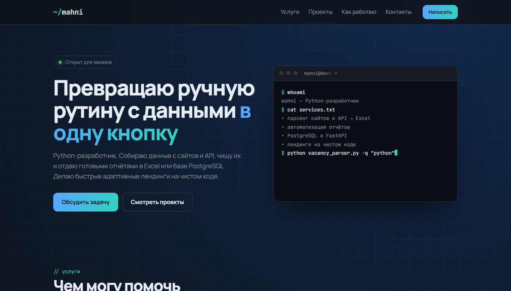

# mahni — личный сайт

**[mahn1.github.io →](https://mahn1.github.io/)**

Сайт-визитка Python-разработчика: услуги, проекты с живыми ссылками, стек и форма для заказа.

## Что внутри

- **Терминал в первом экране** печатает команды и их вывод
- **Проекты** с фильтром «Python / Лендинги»: превью подтягиваются прямо из репозиториев
- **Форма заявки** без сервера: собирает письмо в почтовом клиенте или копирует текст для Telegram
- Адаптивная вёрстка и мобильное меню

## Стек

HTML5 · CSS3 · чистый JavaScript · GitHub Pages

## Контакты

Telegram [@mahnli](https://t.me/mahnli) · gerasimog67@gmail.com
